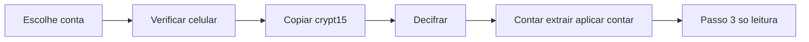

# Passos 1 e 2 reais no Backup WhatsApp

O layout atual permanece: escolha Loja/Vendas, esteira à esquerda, trabalho no centro, guia à direita. Os botões do centro passam a executar. Áudios, transcrição e telefone dos @lid ficam de fora — o item “compacte os áudios” sai do Passo 1, porque o botão Copiar só traz o `msgstore.db.crypt15`. A tabela do Passo 2 mostra conversas e mensagens (antes, depois, novas), sem a linha de áudios.

Decisões confirmadas:
- Coluna do meio tem lista ao vivo (`backup://log`). Chave e URI nunca aparecem.
- “Hoje” é o mesmo dia do calendário em `America/Sao_Paulo`. Ontem à noite já avisa; dá para seguir.
- Se o aplicar falhar no meio, a tela conta o depois mesmo assim e destaca o erro. Reenviar não duplica.

Validação na tela fica com o Marcel. Nesta entrega não se abre browser, não se sobe o dev server e não se testa rota com fetch/curl.

## Fase 1 — Config, Rust e scripts

**Config.** [`config.example.json`](c:\3.1-Projetos2\261018-BACKUPWHATS\config.example.json) versionado, com `chave64` e `supabaseDbUri` vazios. [`config.local.json`](c:\3.1-Projetos2\261018-BACKUPWHATS\config.local.json) com a mesma estrutura, no [`.gitignore`](c:\3.1-Projetos2\261018-BACKUPWHATS\.gitignore). O Rust lê só `C:\3.1-Projetos2\261018-BACKUPWHATS\config.local.json`. Sem o arquivo, a tela diz para preencher e os botões ficam desligados.

**Rust** em [`src-tauri/src/lib.rs`](c:\3.1-Projetos2\261018-BACKUPWHATS\src-tauri\src\lib.rs), quatro comandos, liberados na capability [`default.json`](c:\3.1-Projetos2\261018-BACKUPWHATS\src-tauri\capabilities\default.json):

- `ler_config()` — contas, caminhos e programas. Sem segredos. Cada conta ganha `chaveConfigurada`; a raiz ganha `uriConfigurada`.
- `rodar(conta_id, programa, args)` — `programa` só `adb`, `py` ou `wtsexporter` (caminhos do config). cwd = pasta da conta; stdin nulo; `CREATE_NO_WINDOW`. Troca `{CHAVE64}` pela chave da conta. Injeta `SUPABASE_DB_URI`, `PYTHONUTF8=1`, `PYTHONIOENCODING=utf-8`. Cada linha de stdout/stderr vai ao evento `backup://log` já sem chave e sem URI. Devolve `{ codigo, saida }` também limpo.
- `info_arquivo(conta_id, nome)` — `{ existe, bytes, modificadoEm }`, só dentro da pasta da conta.
- `trocar_arquivo(conta_id, de, para)` — renomeia, só dentro da pasta da conta.

**Scripts** em `scripts/`:
- Copiar [`_referencia/pipeline/261017_2040_extrai_wa.py`](c:\3.1-Projetos2\261018-BACKUPWHATS\_referencia\pipeline\261017_2040_extrai_wa.py) para `scripts/extrai_wa.py`.
- Extrair o Python embutido de [`261017_2225_aplica_wavendas.ps1`](c:\3.1-Projetos2\261018-BACKUPWHATS\_referencia\pipeline\261017_2225_aplica_wavendas.ps1) (linhas 57–148) para `scripts/aplica_sql.py`, sem mudar a lógica.
- Criar `scripts/conta_supabase.py --conta N`, que imprime só `{"conversas":x,"mensagens":y}`: `COUNT` em `apiwhats2.wa_conversa` por conta, e em `apiwhats2.wa_mensagem` com `conversa_id = wa_conversa.id`. URI pela env, nunca impressa.

## Fase 2 — Passo 1 na tela

Funções puras em `src/lib/adb.ts` e travas em `src/lib/travas.ts`. A orquestração chama `invoke` a partir de [`BackupGuia.tsx`](c:\3.1-Projetos2\261018-BACKUPWHATS\src\components\BackupGuia.tsx). A esteira do passo 1 usa os status reais: aguardando, copiando, decifrando.

1. **Verificar celular** — `adb devices -l`. Sem aparelho; não autorizado (texto para aceitar “Permitir depuração USB”); serial diferente do da conta bloqueia. Serial vazio aceita um único aparelho `device` e mostra o serial para cadastrar à mão no `config.local.json` (o app não grava).
2. **Data do backup** — `adb -s <serial> shell "stat -c '%s %Y' '<remoto>'"`. Mostra tamanho e data. `avaliarBackup` compara o dia em Brasília: se for antigo, avisa “faça Fazer backup no WhatsApp” e deixa seguir.
3. **Copiar** — pull para `<pasta>\msgstore.db.crypt15.novo`. Só substitui `msgstore.db.crypt15` se o tamanho bater com o `stat`.
4. **Decifrar** — bloqueia sem `chaveConfigurada`. Na pasta da conta: `wtsexporter -a -b msgstore.db.crypt15 -k {CHAVE64} --no-banner --json --no-html -o resultado`. Sucesso não é o código de saída: `msgstore.db` mais novo que o crypt15 e `py -c` com `sqlite3` em `select count(*) from message` maior que 0.

## Fase 3 — Passo 2 e testes

Seletor 7 / 30 / 180 (padrão 7) e botão Enviar. `podeEnviar` bloqueia se `msgstore.db` não existir, se for mais velho que o crypt15, ou se a URI não estiver configurada.

Ordem: `conta_supabase.py` → `extrai_wa.py --dias` → pegar o `wa_<conta>_*.sql` mais novo em `resultado` → `aplica_sql.py`. Status: enviando, depois concluído.

- Se o extrair falhar, não aplica. O erro fica no log.
- Se o aplicar falhar ou a saída tiver `CONCLUIDO COM ERROS`, conta o depois mesmo assim. A tela mostra conversas e mensagens antes / depois / novas (`novas = depois - antes`) e o erro em destaque.

O Passo 3 e o texto da coluna direita dessa etapa ficam como estão: só explicação, sem botão de Whisper.

**vitest** (ainda não está no [`package.json`](c:\3.1-Projetos2\261018-BACKUPWHATS\package.json)). Testes só das funções puras:
- `parseDevices`: device, unauthorized, saída vazia, linha `* daemon`
- `parseStat`: saída ok e `No such file`
- `avaliarBackup`: mesmo dia em Brasília vs dia anterior (inclusive perto da meia-noite)
- `podeCopiar`, `podeDecifrar`, `podeEnviar`

